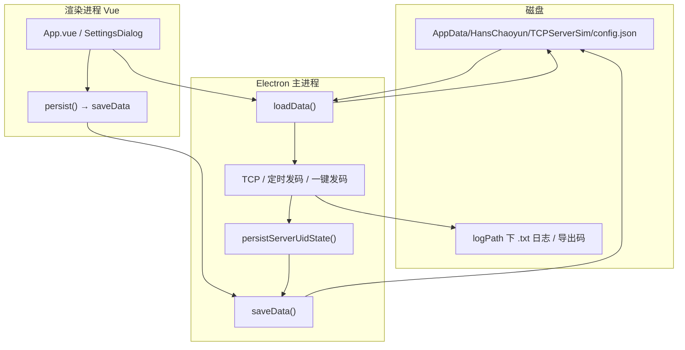

# 配置与 AppData 持久化说明

本文说明 **TCP服务端数据模拟** 如何把用户配置写入磁盘、何时读回、与界面/主进程如何配合，以及如何迁移到其他电脑。

---

## 1. 设计目标

| 目标 | 做法 |
| --- | --- |
| 升级安装不丢配置 | 配置与 `.exe` / 安装目录分离，固定写在系统 **AppData** |
| 单一数据源 | 一台机器一份 `config.json`，包含全局项 + 全部设备 |
| 读写职责清晰 | **渲染进程**负责整表保存；**主进程**在发码/导码等运行时对部分字段做增量写盘 |
| 运行时状态与配置分离 | TCP 连接、发码计数、码包队列、一键发码调度等 **不写入** `config.json` |

---

## 2. 文件路径

### 2.1 正式路径（当前唯一权威位置）

逻辑在 `electron/main.cjs`：

```javascript
function getConfigDir() {
  return path.join(app.getPath('appData'), 'HansChaoyun', 'TCPServerSim')
}

function getConfigPath() {
  return path.join(getConfigDir(), 'config.json')
}
```

| 平台 | 示例 |
| --- | --- |
| Windows | `%APPDATA%\HansChaoyun\TCPServerSim\config.json` |
| 展开示例 | `C:\Users\<用户名>\AppData\Roaming\HansChaoyun\TCPServerSim\config.json` |

> `app.getPath('appData')` 在 Windows 上即 `%APPDATA%`（Roaming），**不是** 安装目录，也 **不是** Electron 默认的 `userData`（一般形如 `%APPDATA%\tcp-server-sim`）。

### 2.2 日志与配置的物理分离

| 内容 | 存放 |
| --- | --- |
| 应用配置 `config.json` | 上表 AppData 目录 |
| 运行日志、生码导出 `.txt` | `config.json` 里的 `logPath`（默认 `文档/tcp-server-logs`，用户可改） |

日志按日追加：`{logPath}/{年}-{月}-{日}.txt`。

---

## 3. `config.json` 结构

经 `normalizeData()` 规范化后，根对象字段如下：

```json
{
  "logPath": "C:\\Users\\...\\Documents\\tcp-server-logs",
  "updateUrl": "https://bnspic.oss-cn-guangzhou.aliyuncs.com/tcp-server-tool",
  "servers": [
    {
      "id": "1731_abc123",
      "enabled": true,
      "enableBatch": false,
      "timedSend": false,
      "enableId": false,
      "enableImport": false,
      "enableLog": true,
      "type": "读码器",
      "name": "读码器1",
      "ip": "192.168.1.10",
      "port": 2001,
      "prefix": "https://www.bottle.com/",
      "suffix": "",
      "codeLength": 20,
      "sendCount": 1,
      "generateCount": 10,
      "cycleMs": 1000,
      "planCount": 0,
      "uidSeq": 1,
      "uidHead": "abcdefghijklmnop",
      "draftCode": "当前待发送内容，多码逗号分隔"
    }
  ]
}
```

### 3.1 根级字段

| 字段 | 含义 |
| --- | --- |
| `logPath` | 日志目录与生码导出目录 |
| `updateUrl` | 在线更新 OSS 根地址（保存时会同步到 `electron-updater`） |
| `servers` | 设备列表（兼容旧字段名 `clients`，读入时会映射为 `servers`） |

### 3.2 单台 `servers[]` 字段

| 字段 | 含义 |
| --- | --- |
| `id` | 稳定主键，TCP 会话、码包 Map 均按此关联 |
| `enabled` | 是否开启 TCP 监听（与「设置-开启」一致） |
| `enableBatch` | 是否参与顶部「一键发送」 |
| `timedSend` | 是否定时发码（会写入配置；启动应用时会清掉，不自动恢复发码） |
| `enableId` / `enableImport` / `enableLog` | 启用 ID、导入码包 UI、写日志 |
| `type` | `PLC` 或 `读码器` |
| `name` / `ip` / `port` | 显示名与监听地址 |
| `prefix` / `suffix` | 码前缀、ID 前后缀 |
| `codeLength` / `sendCount` / `generateCount` | 码长度、单次个数、生码导出条数 |
| `cycleMs` / `planCount` | 发码周期、计划发码数（0=不限） |
| `uidSeq` / `uidHead` | 流水号与固定前段（发码后递增并可能写回） |
| `draftCode` | 界面文本框中的待发内容 |

缺省值、类型矫正（如 `codeLength` 最小 5、`uidHead` 长度补齐）均在 `normalizeData()` / `codegen.cjs` 中完成。

---

## 4. 核心 API（主进程）

### 4.1 `ensureDataFile()`

**首次需要磁盘文件时调用**（读、写前都会走到）：

1. 创建目录 `getConfigDir()`（若不存在）。
2. 若 `config.json` 已存在 → 直接返回路径。
3. 否则按顺序尝试 **旧版迁移**（读到即写入新路径并规范化）：
   - `项目/data/config.json`
   - `项目/data/servers.json`
   - `%APPDATA%/<Electron userData>/config.json`
   - `.../servers.json`
   - `.../clients.json`
4. 仍无有效旧文件 → 写入 `defaultPayload()` 默认配置。

### 4.2 `loadData()`

1. `ensureDataFile()`
2. `JSON.parse` 读 `config.json`，失败则用 `defaultPayload()`
3. `normalizeData(raw)`
4. 返回 `{ ...data, configPath: DATA_FILE }`（多一个 `configPath` 供界面展示）

**不经过 IPC 的内部调用很多**：发码、一键发码排期、合并设备参数等都会 `loadData()` 取 **磁盘上最新** 的 `servers` 条目。

### 4.3 `saveData(data)`

1. `ensureDataFile()`
2. `normalizeData(data)`
3. **整文件覆盖** `fs.writeFileSync(config.json, JSON.stringify(payload, null, 2))`
4. 返回 `{ ok: true, configPath, ...payload }`

### 4.4 `persistServerUidState(serverId, patch)`（主进程增量写）

仅更新 **单台** 设备的字段，用于发码流程中不经过界面的写回：

| patch 字段 | 写回内容 |
| --- | --- |
| `uidSeq` | 下一流水号 |
| `uidHead` | 前段固定串 |
| `draftCode` | 本次生成/发送后的待发文本 |

流程：`loadData()` → 找到 `servers[].id` → 改字段 → `saveData(data)`。

**调用场景（主进程）**：

| 场景 | 通常写入 |
| --- | --- |
| `tcp:buildPayload`（界面「生成码」） | `uidSeq`、`uidHead` |
| 定时发码 tick | `uidSeq`、`uidHead`、`draftCode` |
| 一键发码每次发送 | 同上 |
| 生码导出 `exportCodesToFile` | `uidSeq`、`uidHead` |
| 定时达计划停止 | `persistTimedSendOff` → 仅 `timedSend: false` |

---

## 5. IPC 与 `preload` 暴露

`electron/preload.cjs` → `window.api`：

| 方法 | 主进程 | 作用 |
| --- | --- | --- |
| `loadData()` | `data:load` | 读完整配置 + `configPath` |
| `saveData(data)` | `data:save` | 整表保存；并 `updater.applyFeedUrl(updateUrl)` |
| `getConfigPath()` | `data:configPath` | 仅返回 `config.json` 绝对路径 |

其他 TCP/发码 IPC **不直接替代** `saveData`，但可能触发 `persistServerUidState` 或 `loadData()` 读最新设备参数。

### 5.1 保存时同步更新源

`data:save` 成功后会：

```javascript
if (result.updateUrl) updater.applyFeedUrl(result.updateUrl)
```

检查/回退更新时，若传入的 URL 与磁盘不一致，主进程也会先 `saveData` 再检查。

---

## 6. 何时读取配置

### 6.1 应用启动

```text
app.whenReady()
  → ensureDataFile()          // 保证文件存在 / 迁移
  → stopBatchSend()           // 一键发码状态仅内存，不持久化
  → createWindow()
       → loadData()
       → updater.applyFeedUrl(data.updateUrl)
  → 加载 Vue 界面

界面 onMounted → load()
  → window.api.loadData()     // 再次读盘，填充 servers / logPath / updateUrl
  → 仅恢复 TCP 监听（enabled），不自动恢复定时/一键发码
  → persist()                 // 把启动时的修正（如 timedSend 清零）写回
```

主窗口创建时读一次配置是为了 **更新源**；界面 `load()` 再读一次是为了 **展示与运行态对齐**。

### 6.2 运行中「读盘」的典型时机

| 时机 | 目的 |
| --- | --- |
| `tcp:buildPayload` / `codes:exportFile` | 用磁盘上该设备的 `prefix`、`sendCount`、`enableId` 等与界面传入合并 |
| `runTimedCycleTick` | 定时发码用最新 `timedSend`、`planCount` 等 |
| `getBatchServers()` | 一键发码用最新 `enabled` + `enableBatch` |
| `checkUpdate` / `rollback`（URL 变更） | 读写 `updateUrl` |

即：**关键发码逻辑以磁盘为准**，避免界面未保存时与后台不一致；合并规则为 `serverCfg` 与 `latest` 字段级覆盖（见 `tcp:buildPayload` 内 `merged`）。

---

## 7. 何时写入配置

### 7.1 渲染进程整表保存（`App.vue` → `persist()`）

`persist()` 调用 `saveData({ logPath, updateUrl, servers: snapshotServers() })`。

| 触发 | 说明 |
| --- | --- |
| 应用 `load()` 结束 | 启动修正写回 |
| 设置弹窗保存 | `onSettingsSaved` → `persist(true)` 并提示 |
| 主界面「保存配置」按钮 | `persist(true)` |
| 修改 `logPath`（change） | 自动保存 |
| 设备 `draftCode` / `enableLog` change | 自动保存 |
| 切换定时发码 | `timedSend` 变更后保存 |
| 「生成码」 | 更新 `draftCode`、`uidSeq`、`uidHead` 后保存 |
| 生码导出成功 | 写回 `uidSeq`、`uidHead` |
| 一键发送开始/停止 | 清除各设备 `timedSend` 等后保存 |

设置弹窗本身 **不直接** `saveData`：点「保存」通过 `emit('saved')` 交给 `App.vue` 统一 `persist(true)`。

### 7.2 主进程增量保存

见 §4.4；与界面 `persist()` **可能交错**（例如定时发码写 `draftCode` 的同时用户改设置）。后写入者优先；重要业务字段以 **最后一次 `saveData`** 为准。

### 7.3 **不会** 写入 `config.json` 的内容

| 数据 | 存储 |
| --- | --- |
| 已发条数 `sentCount` | 主进程 `sessions` Map，重启为 0 |
| 导入码包队列 | 主进程 `codePackages` Map，重启清空 |
| 一键发码运行中、事件队列 | `batchState`，仅内存 |
| TCP 连接、定时器句柄 | `sessions`，仅内存 |

`tcp:clearCount` 只清内存计数，不写盘。

---

## 8. 数据流示意



---

## 9. 换机 / 备份 / 还原

1. **备份**：关闭应用，复制整个 `config.json`（必要时连同 `logPath` 目录）。
2. **还原**：在新机安装同版本应用，将 `config.json` 放到同路径（或先运行一次再覆盖）。
3. **注意**：
   - 修改 `ip`、日志路径等适应新环境。
   - **码包需重新导入**。
   - **已发条数** 从 0 开始。
   - `timedSend` / 一键发码不会在中途状态恢复，需手动再开。

仅同步部分设备：编辑 JSON 中 `servers` 数组，合并时注意 `id` 不重复。

---

## 10. 开发与打包差异

| 项 | 开发 `npm run dev` | 打包版 |
| --- | --- | --- |
| 配置路径 | 同上 AppData（非项目目录） | 同上 |
| 首次无文件 | 可迁移 `data/config.json` | 仅默认或旧 userData 迁移 |
| 界面加载 | Vite HMR；主进程改 `main.cjs` 需重启 Electron | 加载 `dist/index.html` |

界面底部提示「配置保存在 AppData」：`configPath` 来自 `loadData()` 的 `configPath` 字段。

---

## 11. 相关源码索引

| 文件 | 职责 |
| --- | --- |
| `electron/main.cjs` | `getConfigPath`、`ensureDataFile`、`loadData`、`saveData`、`normalizeData`、`persistServerUidState`、`data:*` IPC |
| `electron/preload.cjs` | `loadData` / `saveData` / `getConfigPath` |
| `src/App.vue` | `load()`、`persist()`、`normalizeServer`、`snapshotServers` |
| `src/components/SettingsDialog.vue` | 编辑本地副本，`saved` 事件触发保存 |
| `electron/codegen.cjs` | 生码规则（不读写盘，参数来自配置对象） |
| `electron/updater.cjs` | 使用 `updateUrl`（由 `saveData` / 启动时注入） |
| `README.md` | 用户向一句话说明 AppData 路径 |

---

## 12. 常见问题

**Q：改了设置但发码仍像旧参数？**  
A：确认主界面或设置里已保存；发码 IPC 会 `loadData()` 合并磁盘参数。若仅改了未保存的表格，点设置「保存」或主界面「保存配置」。

**Q：生成码后 `uidSeq` 变了但重启又对不上？**  
A：检查是否 `persist()` / `persistServerUidState` 失败；查看 `config.json` 内对应 `uidSeq` 是否更新。

**Q：两个 Electron 实例同时开？**  
A：同一路径 `config.json` 会被后写覆盖，不建议多开。

**Q：配置与 Electron `userData` 关系？**  
A：本项目 **刻意** 使用 `appData/HansChaoyun/TCPServerSim`，仅在 **迁移** 时读取旧 `userData` 下的 json，日常不再写入那里。